# PodVigil Modal

Run bounded batch jobs on [Modal](https://modal.com/) with independent supervision, verified result
backups and resource cleanup.

Maintained by [PolaronQuasi](https://github.com/PolaronQuasi).

This repository is **Modal-only**. It contains the Sandbox runner, Volume recovery, examples and
offline tests. It is an experimental project derived from
[PodVigil](https://github.com/PolaronQuasi/podvigil); the upstream repository is a separate project.
It installs as `podvigil-modal` and does not provide the upstream `podvigil` executable.



## Install

Use a separate virtual environment and activate it before running these commands:

```sh
python -m pip install .
modal token new
podvigil-modal plan examples/modal-smoke/modal-job.json
```

Planning is offline. Before launching, copy the example directory so its relative input paths still
resolve, select your CPU/GPU and resource limits, and refresh its total hourly estimate and
`rate_checked_utc` using current Modal pricing. The example's quote is deliberately expired.

The launch commands below assume that you have prepared `my-job.json` with those input paths.

```sh
podvigil-modal --state-dir ./output/modal-state launch my-job.json --detach
podvigil-modal --state-dir ./output/modal-state status latest
podvigil-modal --state-dir ./output/modal-state list
podvigil-modal --state-dir ./output/modal-state logs latest --lines 50
podvigil-modal --state-dir ./output/modal-state wait latest --timeout 10
podvigil-modal --state-dir ./output/modal-state cancel latest
podvigil-modal --state-dir ./output/modal-state recover latest
```

`python -m podvigil` exposes the same Modal-only commands. The Python import package keeps its
existing name for stored worker commands. Existing Modal ledgers remain readable by their full
paths; no state or result files are automatically moved.

Detached launch prints one JSON line with `job_id` and `ledger` after worker handoff. Use that exact
ledger for concurrent jobs. `podvigil-modal --version` displays version and source commit.

## What it does

- Starts one owned Sandbox and one dedicated Volume with no automatic create retries.
- Runs an independent local worker and a remote supervisor with a finite lifetime.
- Tolerates transient status-read failures and gives cancellation a bounded finalization window.
- Verifies terminal compute state, downloads every Volume file and checks its SHA-256.
- Flushes backup files and, on POSIX, their directories before deleting remote storage.
- Keeps the Volume when recovery or ownership cannot be verified.
- Separates optional startup and run allowances without extending the fixed deadline.
- Cleans up proven no-workload starts through verified inputs-only backup.
- Records phase times, runner identity, sampled GPU use and clearly labelled cost estimates.
- Provides offline `plan`, `status`, `wait`, `list` and cached `logs` without credentials.

## Documentation

- [Manual](docs/MANUAL.md): installation, commands, job fields and workload contract.
- [Operations](docs/OPERATIONS.md): outcomes, cancellation and recovery.
- [Modal lifecycle](docs/MODAL.md): architecture, evidence and operational limits.
- [Development](docs/DEVELOPMENT.md): offline tests, packaging and CI for Linux, Windows and macOS.
- [Contributing](CONTRIBUTING.md), [security](SECURITY.md) and [support](SUPPORT.md).

## Limits and responsibility

Use trusted images and workloads. The workload can access its mounted Volume and supervisor files.
The local worker does not survive a host shutdown; the provider timeout remains the compute
backstop, and recovery must later finish locally. Timeouts and cost estimates are not spending caps.
Storage and other provider charges can remain after compute stops.

Provided under the [Apache-2.0 license](LICENSE), without warranties. You are responsible for your
cloud charges, workloads and backups. Read the [disclaimer](DISCLAIMER.md) before use.
