# Modal Sandbox backend

This experimental utility runs only Modal Sandbox jobs. The executable is `podvigil-modal`. Read the
[manual](MANUAL.md), [operations guide](OPERATIONS.md) and [contract](../CONTRACT.md) before use.



## Install and configure

Use a separate environment for this fork so an existing PodVigil installation stays intact:

On Linux or macOS:

```sh
python -m venv .venv-modal
. .venv-modal/bin/activate
python -m pip install -e .
modal token new
```

On Windows PowerShell:

```powershell
python -m venv .venv-modal
.\.venv-modal\Scripts\python.exe -m pip install -e .
.\.venv-modal\Scripts\modal.exe token new
```

For the following commands on Windows, activate that environment or use
`.\.venv-modal\Scripts\podvigil-modal.exe` in place of `podvigil-modal`.

These commands run from the repository root. Modal SDK 1.6.4 is pinned. Credentials remain in
Modal's local profile or its supported environment variables. Do not put them in a job, command
arguments, inputs, Git, or a workload environment. The controller and independent watchdog compare
keyed credential fingerprints before releasing a job. On Windows, shell-only credentials do not
reach the service-launched watchdog; use Modal's local profile.

An acting command requires the official `https://api.modal.com` endpoint or the SDK's official
`https://api.modal2.com` failover endpoint. `plan`, `status`, `wait`, `list`, `logs` and `--version`
do not import the SDK, inspect credentials or call the provider.

## Commands

```sh
podvigil-modal plan examples/modal-smoke/modal-job.json
podvigil-modal --version
podvigil-modal --state-dir ./output/modal-state launch my-modal-job.json
podvigil-modal --state-dir ./output/modal-state launch my-modal-job.json --detach
podvigil-modal --state-dir ./output/modal-state status latest
podvigil-modal --state-dir ./output/modal-state list
podvigil-modal --state-dir ./output/modal-state logs latest --lines 50
podvigil-modal --state-dir ./output/modal-state wait latest --timeout 10
podvigil-modal --state-dir ./output/modal-state cancel latest
podvigil-modal --state-dir ./output/modal-state recover latest
podvigil-modal --state-dir ./output/modal-state recover latest --accept-partial
```

`JOB` also accepts the exact ledger folder or a unique ID prefix (at least four characters). Modal
ledgers live in `STATE/modal/jobs`. Only Modal ledgers are accepted. `--state-dir` goes before the
command. `latest` uses immutable creation evidence; updating an older job cannot change it.

Launch starts a detached local worker using PodVigil's existing process-isolation handshake. That
worker owns creation, monitoring, termination and recovery in both foreground and detached mode.
While the job remains pending, `--detach` returns code 9 after worker arming and release, with one
JSON line containing `job_id` and `ledger`. This does not mean a Sandbox was allocated or the
workload began. Use that returned path when launching concurrently. Without detachment, launch waits
for the worker's recorded outcome. If the job has already ended before handoff is reported, detached
launch returns that recorded outcome instead.

`status` reads the ledger and returns command success; `job_outcome` preserves the job outcome.
`wait` returns that job outcome. It stops if the heartbeat is stale, or the control loop is stale
outside its bounded startup phase, reporting what may remain. `--timeout` returns `wait_timeout`
(14); Ctrl+C returns 130 and leaves the job unchanged. Progress prints once per phase change;
terminal watchdog, stalled-loop and interruption diagnostics also go to stderr. JSON results go to
stdout.

`cancel latest` and `recover latest` do not silently select an older job when an unreadable ledger
has newer or unknown creation evidence. They name the skipped folder and require an explicit path or
ID. `status`, `wait` and `logs` retain their read-only selection behavior.

Ctrl+C on launch, or `cancel`, writes a local cancellation request. A live worker signals the
supervisor to finalize, then falls back to termination within the original deadline. Publication can
still fail, leaving storage retained. An in-flight SDK create handles cancellation when it returns
or its bounded wait expires. If the worker is dead, `recover` takes the job's OS lock. Before the
deadline it requires `--stop-running` or an existing cancellation request to stop a running Sandbox.
It never starts another Sandbox, resumes monitoring or resets a deadline. A live worker prevents a
second acting worker from taking over. See [recovery details](OPERATIONS.md#recovery).

Refusing to stop a still-running Sandbox returns command code 7 without marking the job finished.
Saved phase/outcome stay unchanged, apart from a newly verified resource receipt where applicable.

## Job fields

Use [the smoke example](../examples/modal-smoke/modal-job.json) as a template. It deliberately has
an expired rate timestamp: refresh the price estimate before an actual launch.

| Field                                  | Meaning                                                                                                                                                                          |
| -------------------------------------- | -------------------------------------------------------------------------------------------------------------------------------------------------------------------------------- |
| `provider`                             | Must be `modal`.                                                                                                                                                                 |
| `app`, `environment`                   | Explicit Modal names. The empty named App is looked up or created; it holds no deployed Functions and is not stopped or deleted by this backend.                                 |
| `image`                                | Trusted public Linux amd64 image containing `python3`, coreutils `sync` and the workload dependencies. Prefer a digest. Builds and pulls may take time and incur separate costs. |
| `gpu`                                  | Explicit GPU type, optionally `:COUNT`, or null for CPU. No fallback or automatic retry.                                                                                         |
| `cpu`, `memory_mib`                    | Requested physical cores and MiB; both are also set as hard resource limits.                                                                                                     |
| `timeout_seconds`                      | Run allowance with an explicit startup field; otherwise the legacy overall allowance. 30–86400 seconds, including finalization.                                                  |
| `finalize_seconds`                     | Reserved time to stop workload children, hash files, and commit the Volume.                                                                                                      |
| `command`                              | Argument array; no implicit shell. Working directory is the uploaded inputs folder.                                                                                              |
| `startup_timeout_seconds`              | Optional start allowance, 1–86400 seconds. Fixes the overall deadline at launch to startup plus run time; omitting it preserves the legacy overall allowance.                    |
| `workload_env`                         | Optional non-secret child environment map. Names and size limits are validated; values persist in plaintext. See the [manual](MANUAL.md).                                        |
| `inputs`                               | Map of remote relative paths to individual files resolved relative to the job file. No whole-directory uploads, credential filenames, or symlinks.                               |
| `required_artifacts`                   | Output-relative paths that must exist for success.                                                                                                                               |
| `estimated_hourly_usd`                 | User-supplied total compute estimate, including GPU, CPU and RAM. This is not fetched from a catalog.                                                                            |
| `rate_checked_utc`                     | Zoned ISO 8601 timestamp, no more than 24 hours old at launch. Planning is allowed with stale quotes.                                                                            |
| `max_compute_cost_usd`                 | Rejects a runtime estimate above this amount; not a provider-enforced spending cap.                                                                                              |
| `block_network`                        | Blocks workload network access when true. Defaults false for dataset/package access.                                                                                             |
| `max_backup_bytes`, `max_backup_files` | Local recovery limits. Exceeding them retains storage; it never silently omits files.                                                                                            |

Configured input and required-artifact paths must be portable across Windows, Linux and macOS. Other
output names can use a mapped backup; symlink targets are saved as metadata without following them.
See [output recovery](OPERATIONS.md#recovery). Each allowance is capped at 24 hours; an explicit
startup allowance plus the run allowance can total 48 hours. These are validation limits, not
recommended first-run durations. Checkpoints must be application-defined; resuming from one means an
explicit new job with that checkpoint supplied as an input. There is no automatic preemption resume
or retry budget in this backend.

## Execution and evidence

The pinned SDK explicitly rejects GPU lists for Sandboxes. Function GPU fallbacks do not apply here;
choose one GPU reservation per job. PodVigil never implements fallback by repeating creates.

1. Stage only explicitly listed input files. Arm an independent local worker and verify its
   credentials match. Cloud access starts only after the controller releases it.
2. Look up or create the empty named App and build the image under the remaining startup allowance,
   then persist a create intent before each Volume or Sandbox request. Create an exclusive named
   Volume v2 and record its returned ID. Record the Sandbox ID and random ownership tags.
3. Run the supervisor as the Sandbox's main entrypoint, with a finite provider timeout and a
   persisted absolute deadline. The workload receives an allowlisted environment with input/output
   directories and rented resource fields, no account token, no Modal Secret and no OIDC token.
   Before launching the child, commit the protocol's `runtime-start.json` gate. A gate commit
   failure cannot launch the workload.
4. Write checkpoints directly to the dedicated Volume. The supervisor calls `sync` every 30 seconds
   while running. A slow periodic commit records a warning and allows work to continue. The
   supervisor stops all workload descendants (including new sessions), records and removes link
   entries, writes a complete file manifest and commits using the remaining finalization time.
5. Verify the receipted Sandbox's ownership tags and observe a terminal `poll()` result twice.
   Accepted termination alone is insufficient. Only then read and recover the Volume.
6. Check owner metadata, every file path, sizes, SHA-256 hashes, persisted local bytes, a second
   remote read of every file, and stable complete inventories. Missing/changed data retains storage.
7. Flush backup files and all new POSIX directory entries, save backup verification, delete the
   exact recorded Volume ID, and read back absence twice. A lost delete response can be resolved
   from that same ledger without creating anything.

The SDK's public `Volume.objects.delete(name)` resolves the name again, leaving a rename/reuse race.
The adapter deliberately uses SDK 1.6.4's `_instance_delete()` on the receipted ID. This is a
private SDK dependency, pinned and covered by a contract test; upgrading Modal requires reviewing
it. One logical SDK create is issued per resource. The SDK itself has transport retries with
idempotency metadata; a returned exception never starts a new logical create. The GPU SDK can wait
up to 21 minutes for scheduling internally, so this adapter wraps create in a cancellable wait
bounded by the remaining allowance. Cancellation asks the SDK to terminate; independent reads are
still required before cleanup is called verified.

An unreceipted Sandbox can be reconciled using the exact intent name in the recorded App and
environment, with both the unpredictable job ID and owner tag matching. A name alone is never
sufficient. The running-GPU lookup fallback is also tried. If name lookup cannot recover a receipt,
`recover --sandbox-id ID` checks both ownership tags before accepting an operator-supplied ID. A
lookup miss is still ambiguous, not permission to retry or delete storage. Unknown Volume creation
cannot be automatically resolved and requires operator investigation. An existing attempt can only
be recovered; it cannot be launched again.

Ordinary failed Sandbox creates are not classified by SDK exception type. The pre-call Volume lookup
guard is defensive: upload normally caches that handle. An owner may explicitly use
`recover JOB --assert-no-sandbox` only after the deadline plus run timeout and a fresh owned lookup
miss. This records an operator assertion, never observed absence; a late start remains possible.
Verified backup and ID-based deletion remain mandatory, and the close returns a non-success outcome.
See [operations](OPERATIONS.md#recovery) before using this option. No automatic close or retry
exists.

## Operational limits

Prefer a small trusted image containing only necessary dependencies; a cached, digest-pinned image
reduces startup uncertainty. Very large images consume pull/build time separately from GPU waiting.
The reported large-image timeouts are not evidence of a universal size limit. Choose a realistic
startup allowance and inspect phase timing before raising it. No timeout automatically retries a
create. See [slow-start outcomes](OPERATIONS.md#slow-start-outcomes).

New jobs commit `runtime-start.json` before launching workload code. After two terminal reads,
absence of that gate is useful only with the recorded protocol and an exact uploaded inventory whose
bytes verify twice. That narrow case cleans its backed-up inputs and returns `no_capacity` (4).
Missing protocol evidence in older jobs cannot be retroactively invented; storage stays retained.

### Startup and run allowances

`startup_timeout_seconds` optionally allows 1–86400 seconds for startup. The fixed absolute deadline
is set at launch before staging and arming, to startup plus `timeout_seconds`. The Sandbox provider
timeout is exactly the run allowance; the supervisor also enforces that allowance from entry,
including metadata commit and finalization, capped by the absolute deadline. Startup that finishes
early does not lengthen the run. The price estimate uses only `timeout_seconds` and plan reports
both allowances. Without the new field, the previous overall timeout semantics remain.

A protocol-1 supervisor entering after that overall deadline exits with code 75 before any Volume
write. Exact inputs-only inventory and verified terminal compute can then establish `no_capacity`
without accepting partial outputs. Older jobs without the start protocol keep their existing path.

A failed start-marker read is uncertainty, reported as `runtime_start_error`, not evidence that the
workload missed its start allowance. The worker retries within the fixed absolute deadline; only a
fresh missing-marker observation after the startup deadline ends startup early. The native run
timeout and explicit cancellation remain effective during a metadata-read outage.

The run window begins at supervisor entry, so initialization, GPU discovery and the committed gate
consume some of it. `finalize_seconds` remains inside that allowance. The workload receives the
remaining pre-finalization seconds, not the full configured duration. The native Sandbox timeout
independently uses the configured run allowance, however early startup completes.

### Resource visibility and cost

The child receives `PODVIGIL_GPU` (sampled model names; `unknown` if GPU discovery fails),
`PODVIGIL_CPU` (requested physical cores), `PODVIGIL_MEMORY_MIB` and `PODVIGIL_SECONDS_AVAILABLE`.
Do not size thread pools from `os.cpu_count()` or the affinity mask alone: visible processors need
not equal rented physical cores. Modal documents two virtual cores per physical core. Use the
requested allocation and measure workload behavior.

When present, `nvidia-smi` supplies best-effort utilization and used-memory samples every five
seconds with a one-second query timeout. No extra Python dependency is installed. Reserved
`outputs/.podvigil/gpu-samples.jsonl` is included in the complete manifest and backup. Final status
shows mean utilization across device observations, peak per-device utilization/memory and sampling
errors. Missing readings are null, not zero. Sampling failures never intentionally fail a workload;
ordinary output-backup integrity rules still apply. The GPU identity is recorded in final verified
status; this is not a live GPU inventory command.

`pricing.py` contains a sanity-check table dated **2026-11-14**, verified against
[Modal pricing](https://modal.com/pricing). Sandbox CPU and memory use their published rates;
Sandbox GPU pricing explicitly refers to standard GPU rates, without a three-times multiplier.
`plan.price_check` reports the computed and user hourly estimates side by side and warns on a user
estimate more than 10% lower. It neither fetches prices nor overrides `estimated_hourly_usd` or
`rate_checked_utc`; those remain authoritative. Update them from current pricing before launch.

Final cost uses the measured supervisor interval through manifest preparation. The pinned public SDK
does not expose an exact full billable Sandbox interval, so this excludes boot, final commit and any
other unobserved time, as well as builds, storage and egress. It is an estimate, not an invoice;
missing timing stays null. Compare it with Modal usage before relying on it for budgeting.

The image and workload are **trusted**. The workload can access its Volume and runtime files; the
workload and supervisor do not have separate privilege boundaries. A manifest proves transfer
consistency, not authenticity against a malicious workload. No account-wide resources or shared
volumes are mounted. Network access depends on `block_network`.

Preemption, OOM, provider termination and machine loss can prevent final publication. Recovery keeps
storage when the manifest is missing. `--accept-partial` is an explicit choice to copy and verify
all currently present files, then delete the Volume; it does not claim a complete training result.
Malformed manifests, ownership mismatches and corrupted files still refuse deletion.

A valid root-level `supervisor-error.json` written after the manifest is the single coverage
exception. Its limited, typed diagnostic is still copied and independently verified like other
files, then exposed in status. It does not change the manifest's workload outcome. See
[recovery](OPERATIONS.md#recovery) for the exact limits and retained refusals.

If the local computer shuts down, Modal's Sandbox timeout remains the compute backstop, but local
backup and storage deletion wait for recovery. The worker does not survive a reboot. A provider or
SDK outage can delay observations and cleanup. Blocking SDK calls can outlast the local allowance;
the remote entrypoint checks the persisted deadline before starting work. A timeout is not a
guarantee about the final invoice. App metadata and provider logs can outlive compute.

The controller and Sandbox need synchronized clocks at startup for the shared absolute deadline and
finalization reserve to align. The entrypoint converts the remaining allowance to a monotonic
deadline after startup, so later wall-clock adjustments cannot extend it. Initial clock skew can
still cause early termination or an incomplete finalization; Modal's separate finite lifetime is the
outer backstop. No clock-skew immunity or guaranteed checkpoint size is claimed.

Storage has separate billing. Modal documents that deleted Volume data can remain billable for up to
four days. No command claims all charges ended just because compute stopped. Configure Modal
workspace budgets separately; this backend does not change account budgets.

## Verification and sources

The ordinary suite uses in-memory fakes only. Install the pinned Modal dependency to run the offline
SDK signature contract test. Linux integration tests run the real entrypoint locally, including
credential filtering, failure, timeout, checkpoint preservation and escaped-child cleanup. No CI job
may create cloud resources. A live smoke test requires an explicit user request.

Earlier smoke evidence covered CPU completion, L4 startup exceeding a short deadline, and L4
completion with verified backup and deletion. It did not establish live cancellation, interrupted
recovery, partial-output recovery or lost-receipt behavior. The owned-Sandbox lookup fallback and
graceful-stop paths have offline regression coverage, not new live validation. Further
owner-authorized live checks should cover long GPU queues, committed Volume visibility after failed
final sync, terminated-GPU lookup, cancellation with and without blocked network, and
interrupted/partial recovery. Compare measured runtime estimates and GPU telemetry with provider
usage. An operator assertion can never prove that an unresolved pending Sandbox will not start
later; live testing does not remove that risk.

- [Sandbox lifecycle and limits](https://modal.com/docs/guide/sandboxes)
- [Sandbox Python API](https://modal.com/docs/sdk/py/latest/Sandbox)
- [Volumes and persistence](https://modal.com/docs/guide/volumes)
- [Sandbox resource requests, limits and pricing](https://modal.com/docs/guide/sandbox-resources)
- [Preemption](https://modal.com/docs/guide/preemption)
- [Budgets](https://modal.com/docs/guide/budgets)
- [Modal pricing](https://modal.com/pricing)
